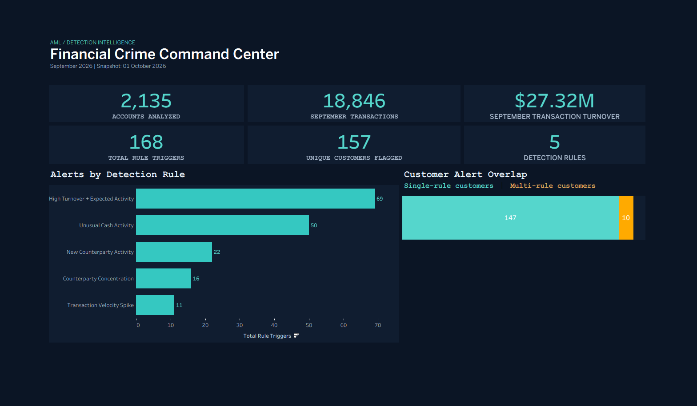
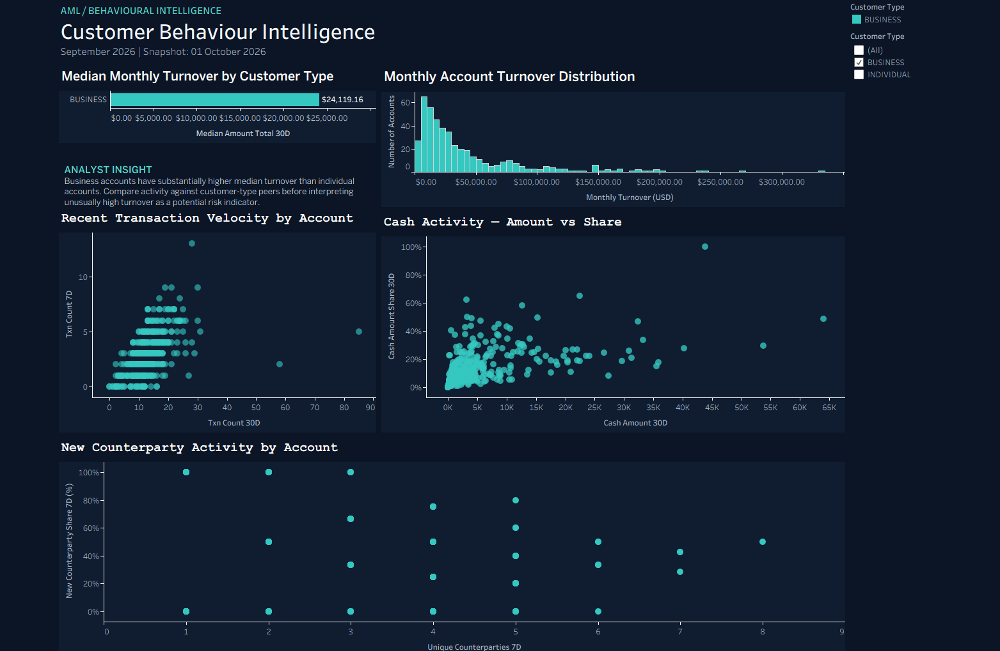
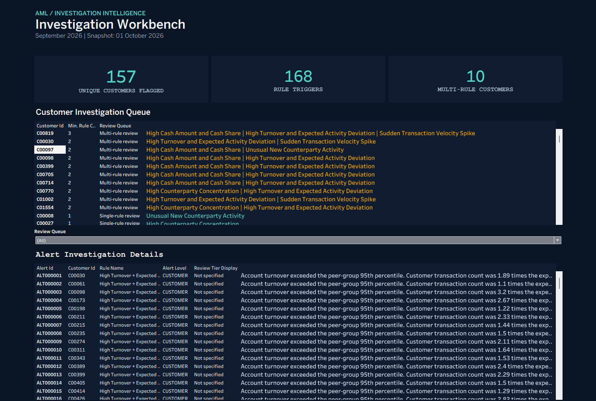

# AML Behavioural Risk Feature Engineering & Detection Intelligence System

**SQL | Python | Tableau | Financial Crime Analytics**

## Project overview

I built this project to practise how an AML analyst can use transaction history to understand customer behaviour and identify accounts that may need further review. I started with synthetic customer and transaction data, prepared account-level features in MySQL, checked the results in Python and created rule-based candidate alerts.

The final dashboards help an analyst review transaction patterns, compare customer groups and move from a flagged customer to the reasons behind their alerts.

This is a **portfolio simulation using synthetic data**. It is not a bank system and the alerts are not confirmed financial-crime cases.

## Dataset and key results

| Measure | Result |
|---|---:|
| Customers | 1,700 |
| Accounts | 2,135 |
| Counterparties | 4,600 |
| Source transactions (Jan–Sep 2026) | 172,276 |
| September 2026 transactions | 18,846 |
| September gross payment activity | $27,315,157.30 |
| Account-level features in final SQL dictionary | 30 |
| Rule triggers | 168 |
| Unique customers with alerts | 157 |
| Customers triggering more than one rule | 10 |

**Reporting cutoff:** 1 October 2026, 00:00:00. The features use a fixed historical snapshot, not real-time monitoring.

## Five detection rules

| Rule | Candidate alerts | Level |
|---|---:|---|
| High Turnover and Expected Activity Deviation | 69 | Customer |
| High Cash Amount and Cash Share | 50 | Account |
| Unusual New Counterparty Activity | 22 | Account |
| High Counterparty Concentration | 16 | Account |
| Sudden Transaction Velocity Spike | 11 | Account |
| **Total** | **168** | |

Some customers triggered several rules. The final customer queue has **147 single-rule customers** and **10 multi-rule customers**. These counts are **rule triggers**, not confirmed suspicious transactions.

## What I did

1. Checked the customer, account, counterparty and transaction tables for missing data, duplicate IDs and inconsistent values.
2. Explored transaction volumes, payment channels and customer segments using MySQL.
3. Built a physical snapshot with activity, amount, cash, counterparty and customer-expectation features.
4. Used Python to review feature distributions, create five transparent detection rules and generate a customer investigation queue.
5. Built three Tableau dashboards and tested their customer-to-alert filtering.
6. Reconciled the final CSVs with the SQL account counts and September transaction totals.

## Tableau dashboards

- **Financial Crime Command Center:** headline figures, alerts by rule and single-rule versus multi-rule customer counts.
- **Customer Behaviour Intelligence:** turnover, transaction frequency, cash behaviour and counterparty activity, with customer-type filtering.
- **Investigation Workbench:** customer queue linked to individual alert details for investigation.

Open `tableau/aml_behavioural_risk.twbx` in Tableau. The workbook was checked locally. A Tableau Public link can be added after the final published-version test.


## Tableau Dashboards

### 1. Financial Crime Command Center



### 2. Customer Behaviour Intelligence



### 3. Investigation Workbench




## Repository structure

```text
aml_behavioural_risk_project/
├── data/                       # Four synthetic source CSVs
├── docs/                       # Feature dictionary, plan and window rules
├── notebooks/
│   ├── feature_analysis.ipynb
│   └── outputs/                # Three final Tableau CSVs
├── sql/                        # Schema, exploratory SQL and snapshot SQL
├── tableau/
│   └── aml_behavioural_risk.twbx
├── README.md
├── analyst_note.md
├── requirements.txt
└── .gitignore
```

## How to reproduce the analysis

**1. Prepare MySQL.** Use MySQL 8.0 or newer. Open `sql/schema.sql` in MySQL Workbench and run it **on a new/empty database**, not over an existing project database. This creates four empty source tables.

**2. Import the CSVs.** Use MySQL Workbench's Table Data Import Wizard to load `customers.csv`, `accounts.csv`, `counterparties.csv` and `transactions.csv` from `data/` into their matching tables. The provided files are standard comma-separated CSVs with a header row. Confirm the import uses the existing table columns and check the dates and number fields.

Expected row counts: **1,700**, **2,135**, **4,600**, and **172,276** respectively. Run the count query at the bottom of `sql/schema.sql` to confirm.

**3. Run the SQL.** `sql/README_sql.md` explains the suggested order for the exploratory scripts. Run `sql/feature_snapshot.sql` after the source tables are populated. It builds `feature_snapshot_20261001` and related `fe_*_work` tables. **Rerunning it replaces those generated tables**, so use a local copy of the synthetic-data database.

**4. Run Python.** In VS Code, open a terminal in the project folder and install the libraries:

```bash
pip install -r requirements.txt
```

Open `notebooks/feature_analysis.ipynb` and run the cells in order. The notebook asks for the local MySQL password using `getpass()` and connects to `aml_behavioural_risk_fe` on `127.0.0.1:3306` as `root`. If your local database settings differ, update that connection cell. The notebook exports:

```text
notebooks/outputs/account_features.csv
notebooks/outputs/alerts.csv
notebooks/outputs/customer_queue.csv
```

**5. Review Tableau.** Open `tableau/aml_behavioural_risk.twbx` to explore the three dashboards. Check the packaged data sources when moving the workbook between computers.

## Important notes

- Some cash transactions have no counterparty ID by design. They were not deleted.
- `NULL` in a calculated ratio can mean no activity or no usable comparison period; it does not mean low risk.
- The turnover and customer-expectation measures are behavioural proxies, not proof of wrongdoing.
- **130 alert review tiers are not specified** in the output. The missing label must not be interpreted as low risk.
- There are no independently confirmed crime labels. It would be incorrect to claim model accuracy, detection precision, recall or false-positive reduction from this dataset.

See `analyst_note.md` for the main findings and investigation priorities, and `docs/feature_dictionary.md` for the feature definitions.
